# Le processus — de « pas designer » à un rendu qui tient

> **Statut : à éprouver.** Assemblé à partir de la recherche du 9-10/10/2026 et du
> [mode d'emploi de stack.md](stack.md). Pas encore
> déroulé de bout en bout sur un projet réel. Chaque étape indique ce qui l'appuie :
> **[doc]** recommandé par une doc officielle, **[étude]** appuyé par une étude,
> **[mesuré]** mesuré dans ce repo, **[hypothèse]** plausible mais sans preuve.

## La carte

Toutes les étapes, les cas de figure, et quel skill ou outil à quel moment. Les
numéros renvoient aux [étapes détaillées](#les-étapes). A se fait avec toi, une
fois par produit ; B tourne dans la factory sans toi ; C revient à chaque fin de
jalon.

```mermaid
flowchart TD
    START(["Besoin visuel"]) --> Q0{"Quel cas ?"}
    Q0 -->|"nouveau produit"| POS
    Q0 -->|"refonte d'un existant"| AUDIT["État des lieux<br/>/impeccable audit<br/>captures visual-check"]
    Q0 -->|"nouvel écran,<br/>DESIGN.md existe déjà"| SPEC
    AUDIT --> POS

    subgraph A["A · Direction — avec toi, une fois par produit"]
        POS{"Positionnement décidé ?<br/>une phrase + le public"}
        POS -->|"non"| DECIDE["Le décider d'abord<br/>sinon le design n'a rien à dire"]
        DECIDE --> POS
        POS -->|"oui"| REF["1 · Références<br/>3 à 5 produits de la même catégorie<br/>inspo MCP · Mobbin · awesome-design-md"]
        REF --> EXT["2 · Extraire des valeurs<br/>/extract designlang · dembrandt"]
        EXT --> QF{"Le design vit<br/>dans Figma ?"}
        QF -->|"non"| CD["3 · Explorer 3 directions<br/>Claude Design : /design-sync<br/>sinon Stitch · maquettes Nano Banana"]
        QF -->|"oui"| FIG["3 · Explorer dans Figma Make<br/>puis Figma MCP + implement-design"]
        CD --> PICK{"Une direction<br/>te parle ?"}
        FIG --> PICK
        PICK -->|"non"| REF
        PICK -->|"oui"| FIX["4 · Figer<br/>DESIGN.md<br/>/impeccable init → PRODUCT.md<br/>DESIGN.md cité dans CLAUDE.md"]
        FIX --> QV{"Besoin de visuels ?<br/>hero, illustrations, vidéo"}
        QV -->|"oui"| VIS["5 · Générer dans un seul style<br/>GPT Image · Nano Banana<br/>pas Midjourney sur un projet client"]
        QV -->|"non"| OUT
        VIS --> OUT[/"Sortie de A<br/>DESIGN.md · PRODUCT.md · assets/"/]
    end

    OUT --> SPEC

    subgraph B["B · Construction — la factory, sans toi"]
        SPEC["6 · Spécifier<br/>plan mode + Claude t'interviewe<br/>/afk-spec pointe vers DESIGN.md"]
        SPEC --> QT{"Quelle surface ?"}
        QT -->|"landing, vitrine"| LAND["7 · impeccable registre brand<br/>ou design-taste-frontend une seule fois<br/>shadcn + Aceternity / Magic UI"]
        QT -->|"app, dashboard"| APP["7 · impeccable registre product<br/>shadcn/ui · densité, cohérence"]
        QT -->|"mobile"| MOB["7 · impeccable registre product<br/>conventions Apple HIG / Material<br/>awesome-ios-design-md"]
        LAND --> QM{"Quel mouvement ?"}
        APP --> QM
        MOB --> QM
        QM -->|"micro-interactions"| EMIL["8 · emil-design-eng<br/>transform + opacity<br/>prefers-reduced-motion"]
        QM -->|"scroll cinéma"| SCROLL["8 · UNE skill scroll<br/>awwwards-motion-site<br/>ou cinematic-scroll-site<br/>GSAP + Lenis"]
        QM -->|"aucun"| BUILD
        EMIL --> BUILD
        SCROLL --> BUILD
        BUILD["Les agents construisent<br/>afk-app.sh · un seul directeur par surface<br/>matériau : MCP magic, catalogue ui-ux-pro-max"]
        BUILD --> GATE{"Gate vérifiable<br/>tests · lint des tokens · contraste axe<br/>LCP / CLS · rien qui déborde à 375 px"}
        GATE -->|"rouge"| BUILD
    end

    GATE -->|"vert, fin de jalon"| SHOT

    subgraph C["C · Passe visuelle — à chaque fin de jalon"]
        SHOT["9 · Captures 375 et 1280 px<br/>visual-check"]
        SHOT --> CRIT["9 · Critique par un sous-agent neuf<br/>contre DESIGN.md et les références<br/>pas de note sur 100"]
        CRIT --> QK{"Écran clé ?<br/>hero, dashboard"}
        QK -->|"oui"| GL["gauntlet-loop<br/>variantes en parallèle<br/>A/B à l'aveugle"]
        QK -->|"non"| QC
        GL --> QC{"Des écarts ?"}
        QC -->|"oui"| TIX["Tickets → nouvelle vague"]
        QC -->|"non"| FIN["Finitions<br/>web-design-guidelines<br/>/impeccable polish"]
    end

    TIX --> BUILD
    FIN --> SHIP(["Livré : tu merges dev → master"])
```



**Ce que la carte ne montre pas, et qui ne se fait jamais** ([stack.md](stack.md#ce-quil-ne-faut-pas-mélanger)) :

- deux directeurs sur la même surface (impeccable puis taste sur la landing, par exemple) ;
- `high-end-visual-design`, ou les skills `design-system` / `ui-styling` du plugin pro-max, à côté d'impeccable ;
- deux skills scroll, ou deux échelles d'easing ;
- un directeur sans `PRODUCT.md` ;
- un composant du MCP `magic` collé tel quel, sans repasser par `/impeccable polish`.

---

## Le diagnostic

Le rendu reste « mid-tier » avec impeccable parce qu'**impeccable polit une
direction, il n'en choisit pas une**. Il part de ce que tu lui donnes — et si tu
ne lui donnes rien, de ses propres choix par défaut, même plus soignés. Les skills
de direction (`frontend-design`, taste) poussent loin des clichés, mais ne te
montrent pas d'alternatives.

Ce qui manque, c'est l'étape d'avant : **voir plusieurs directions et en choisir
une avec des images sous les yeux**. Un non-designer ne sait pas écrire « plus
premium », mais le reconnaît en un coup d'œil — et la recherche dit que ce coup
d'œil dure 50 ms ([recherche.md §4](recherche.md#4-ce-qui-fait--premium--selon-la-recherche-ux)).

Deux autres manques probables, d'après le rapport externe, sans preuve mesurée :
des **visuels propres au site** au lieu de placeholders, et une **animation avec du
rythme** au lieu d'animer partout.

### Ce qui ne va pas dans le workflow actuel

Relevé le 10/10/2026 sur la factory (`/afk-spec`, template web, `afk.sh`) et sur
une refonte réelle menée avec impeccable.

**Dans la factory**

1. **`/afk-spec` exclut le design par construction.** Sa règle : « What no command
   judges — a layout, an animation, a tone — does not go in the spec. It gets
   handled later, by hand, outside the loop. » Les agents construisent donc toute
   l'UI avec leurs choix par défaut, et le design arrive après coup, en refonte :
   l'UI est payée deux fois.
2. **Le template web n'a aucune base de design** : ni `DESIGN.md`, ni `PRODUCT.md`,
   ni impeccable ni emil, rien dans `CLAUDE.md`. Seuls les skills de Wasp. Chaque
   app part du look d'open-saas, un template SaaS générique.
3. **La gate ne regarde jamais le rendu** : compile, types, tests. Ni capture, ni
   contraste, ni LCP / CLS. Le prompt des agents afk ne parle pas de design.

**Dans la refonte observée**

4. **La direction a été générée, pas choisie** : un design system complet écrit en
   une journée par impeccable, sans références ni alternatives comparées.
5. **Ses choix de base sont ceux que la recherche associe au générique** : un accent
   violet et Geist — la police sur laquelle tous les skills tombent d'accord,
   justement parce qu'elle est la plus sûre. Le violet venait du logo, et chaque
   client le remplace par sa couleur, donc c'est en partie justifié. Mais l'ensemble
   lu en 50 ms dit « SaaS standard ».
6. **Le positionnement n'était pas décidé** — `PRODUCT.md` le disait lui-même
   (« Open decision »), logo pas final. Un design ne peut pas affirmer une identité
   que le produit n'a pas encore. Probablement la première cause du rendu
   « mid-tier », avant tout outil.
7. **Aucun visuel propre au site** : le logo, les SVG par défaut du framework, des
   exemples fictifs sur la landing.
8. **La critique était une auto-critique** : `/impeccable critique`, le même modèle
   qui relit son propre travail. La recherche demande une critique sur le rendu, par
   un contexte neuf, comparée à des références.

---

## Le workflow

### A · Direction — avec toi, une fois par produit, 1 à 2 h

Étapes [1](#1-références--3-à-5-sites-de-la-même-catégorie) à
[5](#5-visuels--avant-la-spec-avant-le-hero). Le positionnement en une phrase est
le préalable : sans lui, on s'arrête. Puis références de la même catégorie,
extraction de valeurs, trois directions dans Claude Design, **tu en choisis une**,
on la fige dans `DESIGN.md` + `PRODUCT.md`, et on génère les visuels dans un seul
style.

Sortie : `DESIGN.md`, `PRODUCT.md`, `assets/`, et une capture de la direction
retenue. C'est la seule partie qui demande un humain.

### B · Construction — la factory, sans toi

Étapes [6](#6-spécifier--plan-mode-et-claude-tinterviewe) à
[8](#8-animer--avec-retenue). `/afk-spec` reçoit la sortie de A et la spec pointe
vers `DESIGN.md`.

La règle d'afk tient toujours : **le goût ne va pas dans la gate**. Mais ce qui est
vérifiable par une commande y va :

| Critère | Outil |
|---|---|
| aucune couleur ni police hors des tokens | lint (`shadcn-ui/lint` ou règle maison) |
| contraste WCAG AA | axe |
| LCP et CLS sous un seuil | Lighthouse |
| `prefers-reduced-motion` respecté | test Playwright |
| rien ne déborde à 375 px | test Playwright (`scrollWidth <= clientWidth`) |

Les agents travaillent avec **un seul** skill de direction (impeccable, registre
`brand` ou `product`) et emil pour le mouvement, installés par le template.

### C · Passe visuelle — à chaque fin de jalon

Étape [9](#9-critiquer--sur-le-rendu-par-un-regard-neuf). Captures à 375 et
1280 px, critique par un sous-agent dans un contexte neuf contre `DESIGN.md` et les
références. Les écarts deviennent des tickets qui repartent dans la boucle.
`gauntlet-loop` pour les écrans clés.

### Selon le type de produit

| Type | Registre impeccable | Ce qui compte le plus |
|---|---|---|
| Landing, site vitrine | `brand` | direction forte, visuels propres, mouvement avec rythme |
| App, dashboard | `product` | densité, cohérence, vitesse ; mouvement minimal, conforme aux attentes |
| Mobile | `product` | conventions de la plateforme (Apple HIG, Material) : la conformité aux attentes y est la règle |

---

## Les étapes

### 1. Références — 3 à 5 sites de la même catégorie

**[étude]** Tuch 2012 : « peu chargé » et « conforme à ce qu'on attend de ce type
de site » jouent dès 17 ms. Chercher dans la catégorie de l'app (SaaS B2B, outil
dev, e-commerce…), pas ce qui est le plus original.

- Où : [inspo](outils.md#références) (MCP gratuit, DESIGN.md par site), Mobbin
  (MCP payant), awesome-design-md, Awwwards.
- Demander à Claude ce que les références ont en commun, **sans copier** :

```
Voici 4 sites de référence pour [type d'app] : [urls ou captures].
Dis-moi ce qu'ils ont en commun : densité, typographie, palette, traitement des
images, layout du hero, mouvement. Ce qui me plaît, c'est probablement ça.
Ne propose rien encore, ne copie aucun de ces sites.
```

### 2. Extraire — des valeurs, pas un design

**[hypothèse]** utile, sans mesure : `/extract <url>` (designlang) sur 1 ou 2
références sort une config Tailwind, un thème shadcn et des tokens. On n'en garde
que des valeurs (échelle typo, espacements, rayons), qu'on mélange et ajuste.
Une capture ne montre ni le survol ni le responsive : extraire le vrai DOM donne
plus d'information ([recherche.md §5](recherche.md#5-images-et-vidéo-générées-par-ia)).

### 3. Explorer — 3 directions, en choisir une

Dans **Claude Design** (inclus dans ton plan) : `/design-sync` sur le projet,
donner les références et les valeurs extraites, demander 3 directions distinctes,
itérer sur le canevas (commentaires, curseurs). Alternative : Google Stitch (Agent
Manager, directions en parallèle) ou des maquettes en image avec Nano Banana.

```
À partir de ces références et de ces tokens, propose 3 directions visuelles
nettement différentes pour la page d'accueil de [produit] :
une sobre et dense, une éditoriale, une plus expressive.
Pour chacune : palette, paire de polices, layout du hero, traitement des images,
niveau de mouvement. Rien de générique : pas d'Inter par défaut, pas de dégradé
violet, pas de trois cartes égales.
```

Choisir **une** direction. C'est la seule décision de design que tu prends
vraiment — tout le reste en découle.

### 4. Figer — un fichier que les agents lisent

- `DESIGN.md` (export Claude Design / Stitch, ou écrit à partir de la direction) :
  palette, typo, espacements, rayons, ombres, règles des composants, ce qui est
  interdit.
- `/impeccable init` : `PRODUCT.md` (public, registre `brand` ou `product`, voix).
  **[mesuré]** sans lui, impeccable refuse et chaque session redevine
  ([stack.md](stack.md#ce-que-ça-donne-en-vrai--mesuré)).
- Référencer `DESIGN.md` dans `CLAUDE.md` : Claude Code ne le lit pas tout seul.

```
Écris DESIGN.md à partir de la direction retenue :
- palette (primaire, secondaire, accents, neutres) en OKLCH ou hex, avec les rôles
- typographie : familles, échelle de tailles, graisses, interlignage, approche
- échelle d'espacement, rayons, ombres
- règles de mouvement : durées, courbes, ce qui bouge et ce qui ne bouge pas
- composants de base et leurs états (bouton, carte, nav, champ)
- ce qui est interdit sur ce projet
Sois précis : un autre agent doit pouvoir construire sans te poser de question.
```

### 5. Visuels — avant la spec, avant le hero

**[hypothèse]** levier fort selon le rapport externe, aucune étude. **[étude]** les
photos de stock génériques sont ignorées (NN/g).

- Générer les images du hero et des sections dans **un seul style**, décrit dans
  `DESIGN.md`, rangées dans `assets/`.
- **GPT Image ou Nano Banana** pour un usage commercial ; éviter Midjourney sur un
  projet client (licence perpétuelle, public par défaut) — [outils.md](outils.md#visuels--images-et-vidéo).
- Vidéo hero : `poster` obligatoire, vérifier le LCP.

### 6. Spécifier — plan mode, et Claude t'interviewe

**[doc]** best practices Claude Code : explorer → planifier → coder ; sur une grosse
fonctionnalité, se faire interviewer (UI/UX comprise), écrire une spec, implémenter
dans une session neuve. Dans la factory, c'est l'entrée de `/afk-spec` : la spec
pointe vers `DESIGN.md` et `PRODUCT.md`.

```
Avant de coder : interviewe-moi sur ce qui manque pour construire [page] sous
DESIGN.md et PRODUCT.md — objectif de la page, audience, ton, sections, CTA,
contenu réel disponible. Puis propose un plan section par section et attends.
```

### 7. Construire — un seul directeur

**[mesuré]** un seul directeur par surface : deux se contredisent sur les polices,
les cartes, les fonds ([stack.md](stack.md#le-vrai-test--est-ce-quelles-disent-la-même-chose-)).

- UI produit : **impeccable** mène (registre `product`).
- Landing sans système : **design-taste-frontend** une fois, puis ancrer dans
  `DESIGN.md`.
- Mouvement : **emil-design-eng** fait autorité.
- Composants : shadcn/ui ; Aceternity / Magic UI au cas par cas sur la landing.
- **[hypothèse]** hero d'abord, puis section par section.

### 8. Animer — avec retenue

- **[doc]** seulement `transform` et `opacity` ; `prefers-reduced-motion` ; GSAP
  gratuit en commercial.
- **[hypothèse]** alterner sections animées et sections calmes.

```
Propose le mouvement section par section, sans coder : ce qui bouge, comment,
pourquoi. Alterne des sections animées et des sections qui respirent. Uniquement
transform et opacity, et une version prefers-reduced-motion pour chaque effet.
```

### 9. Critiquer — sur le rendu, par un regard neuf

**[étude]** itérer aide quand chaque tour voit le rendu (+6,2 % contre +1,5 % sans,
sur du code d'UI) ; une IA qui se note sans voir peut dégrader. **[doc]** capture,
comparaison, liste des écarts, correction.

- Captures à **375 px et 1280 px** avec `visual-check`.
- Critique par un **sous-agent dans un contexte neuf**, qui compare les captures à
  `DESIGN.md` et aux références — pas l'agent qui a écrit le code.
- Variantes en concurrence : `gauntlet-loop` (builders parallèles, critique neuf,
  A/B à l'aveugle).
- Fin : `web-design-guidelines`, `/impeccable audit`.

```
Tu n'as pas écrit cette page. Voici les captures à 375 et 1280 px, DESIGN.md et
les références. Liste les écarts concrets avec DESIGN.md, puis les 5 problèmes
qui font le plus « généré par IA » : hiérarchie, densité, typo, images, cohérence.
Pour chacun : où, pourquoi, correction précise. Pas de note sur 100.
```

---

## Ce qu'il faut changer, dans l'ordre

1. **Éprouver A à la main** sur une refonte réelle : positionnement d'abord, puis
   références et trois directions dans Claude Design. Intention notée dans
   `~/notes/adcom-design.md`.
2. **Template web** (`app-templates/templates/web`) : `DESIGN.md` et `PRODUCT.md` à
   remplir, impeccable et emil installés, `DESIGN.md` cité dans `CLAUDE.md`,
   `visual-check` branché, critères vérifiables de B dans la gate.
3. **`/afk-spec`** — repo public, donc un changement générique : si un `DESIGN.md`
   existe, la spec y renvoie et ajoute les critères vérifiables. Le goût reste hors
   de la gate.
4. **Plus tard** : un skill `/design-direction` qui enchaîne A, et la passe C en
   fin de jalon dans `afk-app.sh`. Seulement après avoir déroulé A à la main au
   moins une fois.

---

## Checklist

**Avant le code**
- [ ] 3 à 5 références de la même catégorie, et ce qu'elles ont en commun
- [ ] valeurs extraites d'1 ou 2 références
- [ ] 3 directions vues, **une** choisie
- [ ] `DESIGN.md` écrit, référencé dans `CLAUDE.md`
- [ ] `PRODUCT.md` (`/impeccable init`)
- [ ] spec en plan mode, après interview

**Pendant**
- [ ] un seul directeur sur la surface, emil pour le mouvement
- [ ] visuels générés dans un style, licence compatible
- [ ] aucun placeholder ni photo de stock générique
- [ ] animations : `transform` / `opacity`, `prefers-reduced-motion`
- [ ] vidéo : `poster`, LCP vérifié

**Avant « c'est bon »**
- [ ] captures 375 / 1280 px
- [ ] critique par un contexte neuf contre `DESIGN.md`
- [ ] `web-design-guidelines`
- [ ] premier jet traité comme un brouillon, mais corrigé sur ce qu'on voit, pas
      réécrit par principe
